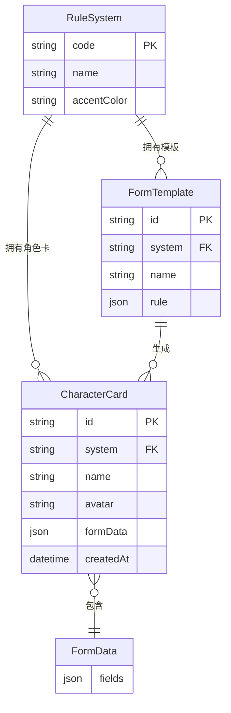

# 跑团角色卡平台 - 技术架构文档

## 1. 架构设计

项目采用 **Vue 3 单仓库双端** 架构：网页端（桌面设计器）与小程序端（移动模拟）同处一个 Vue 3 + Vite 项目，通过路由区分。角色卡数据以 JSON 文件形式集中存储在 `src/data/cards/` 下，两端共享同一套数据模型与类型定义。

```mermaid
flowchart TD
    subgraph "前端层"
        "A1[网页端设计器 vue-router /designer]"
        "A2[小程序端模拟 vue-router /miniapp]"
    end
    subgraph "数据层"
        "B1[角色卡 JSON 文件 src/data/cards]"
        "B2[表单模板 JSON src/data/templates]"
        "B3[共享类型定义 src/types]"
    end
    subgraph "外部库"
        "C1[form-create-designer 表单设计器]"
        "C2[form-create 表单渲染器]"
    end
    "A1" --> "C1"
    "A1" --> "C2"
    "A2" --> "C2"
    "C1" --> "B2"
    "C2" --> "B1"
    "A1" --> "B1"
    "A2" --> "B1"
```

## 2. 技术说明

- **前端框架**：Vue 3 + TypeScript + Vite
- **样式**：TailwindCSS 3
- **路由**：vue-router 4
- **表单设计器**：`@form-create/designer`（form-create-designer）
- **表单渲染**：`@form-create/element-ui` 或 `@form-create/iview`（用于小程序端卡片放大查看时的表单渲染）
- **UI 组件库**：Element Plus（与 form-create-designer 配套）
- **状态管理**：Pinia（轻量，符合 Vue 3 推荐）
- **初始化工具**：vite-init（vue-ts 模板）
- **后端**：无（纯前端，数据以静态 JSON 文件形式存在）
- **数据库**：无，使用静态 JSON 文件模拟数据源

## 3. 路由定义

| 路由 | 用途 |
|------|------|
| `/` | 网页端入口，重定向至 `/designer` |
| `/designer` | 网页端表单设计器（桌面三栏布局） |
| `/miniapp` | 小程序端模拟外壳（含底部 Tab） |
| `/miniapp/home` | 小程序-卡面展示页 |
| `/miniapp/profile` | 小程序-个人中心页 |
| `/miniapp/card/:id` | 小程序-卡片放大详情页（也可作为模态弹出） |
| `/about` | 关于页 |

## 4. API 定义

无后端 API。数据通过前端静态 JSON 文件加载：

```typescript
// src/types/card.ts
export type RuleSystem = 'COC' | 'DND' | 'DAGGERHEART'

export interface CharacterCard {
  id: string
  system: RuleSystem
  name: string
  player?: string
  avatar?: string
  description?: string
  // 表单可视化数据（由 form-create schema 渲染）
  formData: Record<string, unknown>
  createdAt: string
  updatedAt: string
}

export interface FormTemplate {
  id: string
  system: RuleSystem
  name: string
  // form-create 的 rule schema
  rule: unknown[]
}
```

## 5. 服务器架构

无服务器，纯前端项目。

## 6. 数据模型

### 6.1 数据模型定义



### 6.2 数据定义语言（静态 JSON 示例）

由于无数据库，使用静态 JSON 文件作为"表"：

**`src/data/systems.json`** - 规则系统表：
```json
[
  { "code": "COC", "name": "克苏鲁的呼唤", "accentColor": "#3B6B4A", "logo": "🌿" },
  { "code": "DND", "name": "龙与地下城", "accentColor": "#C8A046", "logo": "🐉" },
  { "code": "DAGGERHEART", "name": "匕首之心", "accentColor": "#9BA8B5", "logo": "🗡️" }
]
```

**`src/data/cards/coc-*.json`** - COC 角色卡示例：
```json
{
  "id": "coc-001",
  "system": "COC",
  "name": "艾琳·哈丁",
  "player": "玩家A",
  "avatar": "",
  "description": "1920年代的私家侦探",
  "formData": {
    "age": 32,
    "occupation": "私家侦探",
    "str": 60, "con": 70, "siz": 55, "dex": 65,
    "app": 50, "int": 75, "pow": 60, "edu": 80,
    "san": 60, "hp": 12, "mp": 12
  },
  "createdAt": "2026-01-01T00:00:00Z",
  "updatedAt": "2026-01-01T00:00:00Z"
}
```

**`src/data/templates/coc-template.json`** - COC 表单模板（form-create rule）：
```json
[
  { "type": "input", "field": "name", "title": "姓名", "value": "" },
  { "type": "input", "field": "occupation", "title": "职业", "value": "" },
  { "type": "number", "field": "age", "title": "年龄", "value": 0 },
  { "type": "group", "title": "基础属性", "children": [
    { "type": "slider", "field": "str", "title": "力量 STR", "value": 50, "props": { "min": 1, "max": 99 } },
    { "type": "slider", "field": "con", "title": "体质 CON", "value": 50, "props": { "min": 1, "max": 99 } }
  ]}
]
```
